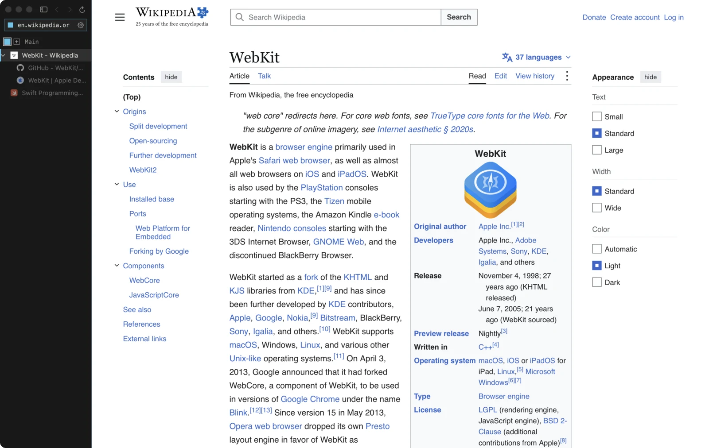

<p align="center">
  
</p>

<h1 align="center">angl</h1>

<p align="center">
  A small, keyboard-first browser for macOS.<br>
  Tree tabs, Spaces with isolated Containers and plain-file config, on the system WebKit.
</p>

<p align="center">
  <a href="https://github.com/btuckerc/angl-browser/releases/latest"><b>Download for Apple Silicon</b></a> ·
  <a href="#build-from-source">Build from source</a> ·
  <a href="#use">Use</a> ·
  <a href="#limits">Limits</a>
</p>

<p align="center">
  
</p>

Per-site JavaScript, blocker, dark mode and volume controls, Bitwarden and Apple Passwords,
and no URL bar unless you want one. Inspired by dacctal's LibreWolf + Sidebery + userChrome
setup ("what browser is that?").

The engine is the system WKWebView (WebKit, updated with macOS) in a Swift 6 / AppKit shell.
No bundled engine, no Electron: the app is a few MB and shares WebKit with the OS.
On en.wikipedia.org/wiki/WebKit, total footprint (app plus its WebKit processes) was
227 MB for angl, 287 MB for Safari and 427 MB for Search.app.

## Install the app

Download the ZIP from [GitHub Releases](https://github.com/btuckerc/angl-browser/releases/latest),
unzip it and move **angl.app** to **Applications**. Requires macOS 15 or later on Apple Silicon.

Release downloads are Developer ID–signed and notarized by Apple, with a stapled ticket; macOS
may still ask you to confirm opening a downloaded app. There is no automatic updater: quit angl
and replace it with the latest download. `>Make angl the Default Browser` in the command
palette (⌘K) registers it for http/https.

## Build from source

Requires a Mac with Xcode 27 (Swift 6.4, macOS 27 SDK) and [rustup](https://rustup.rs) for the
Bitwarden bridge (`bitwarden/rust-toolchain.toml` pins the toolchain).

```sh
git clone https://github.com/btuckerc/angl-browser.git
cd angl-browser
scripts/bitwarden.sh && swift test                # builds the Bitwarden bridge, runs the unit tests
ANGL_SIGN_IDENTITY=- scripts/bundle.sh --install   # ad-hoc signed; replaces /Applications/angl.app
```

`bundle.sh` builds the Bitwarden SDK bridge (`scripts/bitwarden.sh`: `bitwarden/` →
`build/bitwarden/libangl_bitwarden.a`), builds release, compiles the filter lists (daily), compiles the icon
(`packaging/AppIcon.icon`, an Icon Composer vector, via `actool` into `Assets.car` + `.icns`),
assembles `build/angl.app`, signs it with hardened runtime (`ANGL_SIGN_IDENTITY`, default the
maintainer's Developer ID) and with `--install` replaces `/Applications/angl.app`.

Converting and compiling the lists into WebKit content rules (on first launch after they change,
and on every list update) runs in a short-lived `angl --lists` child process, so its several
hundred MB peak never lands in the browser's own footprint.

### Releases

Published builds go through the maintainer's shared `mac-releases` pipeline (`release.py build angl`
→ `notarize` → `draft` → `publish`), which runs `scripts/build-release.py`: the same bundle with the
release version and build number and a secure timestamp, then Apple notarization and a stapled
ticket. Tags are `vVERSION` and match `VERSION`.

## Use

- **No URL bar** by default: **⌘T** floats an address box over the page (a new tab opens
  only when you commit) and, until you type, lists your other tabs, most recent first, so
  ⌘T Return goes back to the last one. **⌘L** or a click on the sidebar's address pill edits
  the current URL, **⌘K** opens it with `>` for commands (`>js off`, `>dark force`,
  `>profile work`, `>open safari`, `>container work`, `>space 2`); a bare `>` lists every
  command. Commands whose title starts with what you typed come first; Tab 1… and Space 1…
  come last unless you type a digit.
  Return opens here, ⌘Return as a child tab, ⇧Return in a new window. Lists longer than
  eight rows scroll, and ↑ ↓ reach every match; an open tab hides the same page's history
  and bookmark rows. An empty tab holds the same field in the page, next to the
  `angl` wordmark, with a blinking accent block for a caret; Esc clears it, then lets go.
  Appearance › Empty tab › Wordmark only turns that off, and Empty-tab caret › System keeps
  the field with the system caret (`"window": {"newTab": "mark"}`, `{"caret": "native"}`).
  Appearance › Address › Bar brings back the always-visible field (`theme.json`:
  `"window": {"address": "bar"}`).
- **Tabs** form a tree: links opened with ⌘-click, middle-click or `window.open` become
  children. ⌘⌥↑/↓ parent/child, ⌃Tab or ⌘⇧[ ] cycle, ⌘1…9, ⌘W closes (on the window's
  last page, in every Space, it closes the window; Settings › Tabs & Spaces turns that off),
  ⌘⌥W closes with children, ⌘⇧T reopens the last closed tab (`a ` in the palette searches
  archived ones). Drag rows to re-parent; right-click for pin, duplicate, folders,
  Container and Space moves. Pinned tabs sit above the tree as titled rows. A speaker
  marks tabs making sound (WebAudio included); muted tabs show it struck through.
- **Bookmarks** (⌘D) come up in the palette (`b ` searches only them). Right-click a
  bookmark there or in Favorites to open it in a new tab, window or split, copy the link,
  add or remove it from Favorites, edit its title and address, or delete it.
- **Spaces** (⌃1…9, ⌃⇧←/→, the squares in the sidebar; ＋ adds one) each have a tab tree
  and a default Container; `angl://spaces` edits and deletes both (deleting a Container erases
  its cookies and storage; its Spaces and tabs move to another). A new Space shares the current
  Container. Containers have separate cookies and storage, an optional HTTP/SOCKS5 proxy
  and clear-on-quit; a tab can override its Container from the site panel. URL rules move
  matching sites into a Space (Settings › Tabs & Spaces › Route tabs by URL).
- **Settings › Tabs & Spaces**, all optional: *Unload after* (off by default; set
  minutes) unloads idle tabs (pins, playing media, camera/mic and visible panes exempt). *Archive
  inactive tabs* (off) moves tabs idle for 24 hours to History › Archive. *Favorites row* (off) shows bookmarked
  favourites as an icon row in every Space. *Split view* (off) shows two tabs of a Space side
  by side: ⌥⌘\\ picks the second tab or exits, ⌥⌘←/→ moves focus (the focused pane has an
  accent outline), drag the divider.
- **Site controls** (⇧⌘I or the gear in the address pill): JavaScript (⇧⌘J), blocker, remote fonts,
  square corners (⇧⌘U), dark mode (⇧⌘D, off/auto/force), hardening, volume −30…0 dB,
  mute (⇧⌘M, the whole page including WebAudio), zoom.
- **Night audio** (Settings › Pages & media › Media, off): compresses loud/quiet swings in Media Source
  video (YouTube, Twitch) with Web Audio's `DynamicsCompressorNode` at FrankerFaceZ's defaults
  (threshold −50 dB, knee 40, ratio 12, release 0.25 s). WebKit outputs silence when a page routes
  MediaSource video through Web Audio (FFZ's approach), so a page script decodes the audio the
  site appends with WebCodecs, plays it compressed in sync with the video and turns the video's
  own audio track off. No permissions; everything stays in the page. Switching it on applies from
  the next page load; switching it off takes effect at once.
- **Video full screen** (Settings › Pages & media › Media): a page's full-screen button (YouTube,
  Twitch, any HTML5 player) fills the screen at once, in the current Space, with no macOS
  full-screen animation: the window goes borderless over the whole screen (below the notch), the
  menu bar and Dock auto-hide, and Esc or the page's own button puts everything back. *Fill the
  window* only hides angl's chrome; *macOS full screen* keeps WebKit's own (a new Space).
  angl enters once per click or key press in the page, and says so with a toast. The page's
  element is put in the top layer with the browser's full-screen styling, but CSS written for
  `:fullscreen` doesn't match it; players styled only that way look wrong — pick *macOS full
  screen* for them. Players in iframes (embeds) and elements in shadow trees keep WebKit's full
  screen. Applies from the next page load.
- **Picture in Picture** (⌥⌘P): the page's playing video (or its largest) floats in macOS
  Picture in Picture; again to bring it back. *Picture in Picture on tab switch* (off) does it
  for you when you leave a tab with a playing video, and ends it when you come back. A video you
  put in Picture in Picture yourself stays there when you leave its tab and come back.
- **YouTube quality** (Settings › Pages & media › Media, Auto): each video starts at the best
  quality it has up to the chosen one (720p…4K, Highest), as if picked in the player's menu;
  picking another there still works. Applies from the next page load.
- **Hardening** (Settings › Privacy & blocking › Security › WebKit restrictions, or per site): `noJIT` runs JavaScript without the JIT
  (macOS 26.4+), `lockdown` is WebKit Lockdown Mode. JavaScript itself stays on by default;
  switch it off globally or per site.
- **Forget on quit** (Settings › Privacy & blocking › Site data, off): deletes every site's cookies and
  storage at quit except the domains in *Except* (default google.com, youtube.com).
- **Passwords** (Settings › Passwords): Bitwarden built in (the official Bitwarden SDK runs
  in-process; bitwarden.com, bitwarden.eu, or a self-hosted Bitwarden or Vaultwarden server —
  pick *Self-hosted* in the login sheet and enter its address) and Apple Passwords. Focusing a
  sign-in field drops a picker under it — *Log in to Bitwarden…* / *Unlock Bitwarden…*, then
  the logins Bitwarden matches to the frame (its URI match rules and equivalent domains),
  this host's own first, then *Other logins on* the domain, URI-rule and equivalent-site
  matches under their own headings; within each, the account the page already shows, then the
  login last filled here, favorites, name. Rows show the site's icon, name, username and where
  the login is saved when that isn't this host. A login for this very host is preselected, so
  **↩** fills it; otherwise ↩ stays the page's until ↓ picks a row. Typing in the username
  field narrows the list (and takes the selection away); ↑ ↓ esc work while it is up.
  **⌘\\** offers logins on demand; again (or *Search Bitwarden…*) searches the whole vault by
  name, username or site. Filling a login saved for another site asks first (*Fill Once*;
  the login isn't changed). Picking fills
  username and password (never submits), asks for the master password first on re-prompt
  logins, and, with **Copy one-time code after filling** (off by default), copies the TOTP code
  if there is one and the password was filled. A one-time code field (`autocomplete="one-time-code"`,
  a field named or labelled for an authenticator code, one-digit boxes, or a short numeric field
  in a form that asks for "the code") lists the page's logins that have a TOTP code; picking one
  fills the current code (a digit per box for split fields). On focus that list appears only
  when there are codes to offer (or, locked, on a field marked `one-time-code`); **⌘\\** always
  offers it. Which login was last filled is kept per
  profile (IDs and times only) for the ordering. Two-step login takes authenticator, email and YubiKey OTP codes; for Duo or
  security keys log in with a personal API key. The encrypted vault is cached in the profile,
  so unlocking works offline, and syncs when the server reports a change. Keys stay in memory
  (with **Unlock with Touch ID**, also sealed to the Secure Enclave and opened by Touch ID or the
  login password); Edit › Lock Bitwarden, 15 idle minutes (*Lock when idle for*), quit,
  sleep or screen lock drops them from memory.
  *Apple Passwords…* opens a native sheet with the system AutoFill picker and
  fills what you choose there. Settings › Passwords turns either off.
- **Passkeys** come from Bitwarden: a site's passkey sign-in or registration opens a native
  sheet (choose the passkey, or the login to save a new one in) and Touch ID or the login
  password; Bitwarden's SDK checks the site against its origin and signs. New passkeys are
  saved to the server before the site gets them. Passkey autofill (a site's conditional
  request with an `autocomplete="… webauthn"` field) lists the site's passkeys at the top of
  the login picker; picking one asks for Touch ID and signs in. Requests Bitwarden can't serve
  (no passkey for the site, Bitwarden off, conditional registration) go to WebKit.
- **Ad blocker**: AdGuard Base + Tracking Protection (Safari-optimized lists, converted
  by AdGuard's SafariConverterLib into WebKit content rules) plus AdGuard Scriptlets and
  cosmetic rules for sites such as YouTube. Settings › Privacy & blocking › Filter lists picks lists (toggling one
  rebuilds), toggles the advanced rules; the site panel turns the blocker off per site.
  **AdGuard Cookie Notices** (off by default) hides consent banners and clicks some away —
  often "reject", sometimes "accept"; it goes off with the site's blocker.
- **Twitch emotes**: BTTV, FFZ and 7TV emotes render in twitch.tv chat (Settings › Pages & media › Twitch chat:
  per provider, animated or still, or off).
- **YouTube video stills** (Settings › Pages & media › Media, on): thumbnails show one of the
  stills YouTube generates from the video (the middle of its three, at the smallest size that
  matches the card: `sd2` for grid cards, `hq2` if an old video has none, and `mq2` for the
  sidebar on a Retina screen) instead of the uploader's image. *Original* on a hovered
  thumbnail swaps back. A WebKit rule list stops the uploader's card images downloading first
  (WebKit fetches an image before a page script can swap it). Same files as Clickbait Remover
  and DeArrow's fallback; no third-party service.
- **Focus mode** ⇧⌘\ hides the chrome; ⇧⌘L (or the sidebar button next to the traffic
  lights) hides the sidebar; hover the left edge to peek. Appearance sets the edge catch
  width (0 turns peeking off), peek/hide delays, and whether the Space selector sits
  at the top or bottom of the sidebar.
- **Keyboard and VoiceOver**: ⇧⌘E puts the keyboard in the tab tree, where an accent outline
  marks the row the arrow keys are on. VoiceOver reads and presses the sidebar buttons, the
  address pill, Space squares, pinned tabs, favourites and palette rows, hears toasts, and
  names the window after its page.
- **Window outline** (Appearance): none (default) leaves the edge to macOS, seam colours
  the sidebar divider, content insets the page in a rounded frame. Colour: accent, border,
  active container or custom; width and active/inactive opacity are adjustable. The accent
  swatches are angl, white, blue, yellow, pink, or any custom colour. Hairlines and borders
  are tinted from the accent unless `theme.json` pins `"color": {"border": "#rrggbb"}`.
- **Snapshots** (⇧⌘S, automatic every 10 min) save every window, Space and tab;
  `angl://snapshots` restores them. ⇧⌘O hands the page to another installed browser.
- Pages: `angl://settings`, `spaces` (Spaces and Containers), `sites`, `history` (⌘Y), `downloads` (⌘⌥L),
  `snapshots`, `about` (profiles, import from Safari/Chrome/Search, keys).
- **Settings** (⌘,) is one searchable page: ⌘F or / searches every label, description and value,
  *Modified* shows only what differs from the defaults, and each row's ⋯ resets it and shows its
  default. Web Inspector attaches only to tabs you open it on (⌥⌘I) unless *Inspectable tabs* is on.
- **History** (⌘Y) lists visits newest first, grouped by day, with Archive and Closed tabs
  beside it. ↓ from the search box walks the rows, ⌫ forgets the focused one, ⎋ returns
  to search. The palette's `h ` filter ranks the same history by frecency instead.
- **Speed**: on AC power pages render at the display's refresh rate (120 Hz on ProMotion)
  instead of WebKit's 60 Hz default; on battery WebKit's default stays (an open tab follows a
  power change the next time it is shown). While you type in the address box, angl opens the
  connection to where Return would go (the search engine, or a page from history or
  bookmarks), so the page starts sooner.
- `>Make angl the Default Browser` registers angl for http/https.

## Files

| Path | What |
|---|---|
| `~/.config/angl/theme.json` | colours, fonts, sizes (live-reloaded) |
| `~/.config/angl/settings.json` | any subset of the settings |
| `~/.config/angl/keys.json` | `{"tab.new": "cmd+t", "tab.mute": ""}`; ids on `angl://about` |
| `~/.config/angl/css/_global.css`, `<host>.css` | user CSS for every page / one site |
| `~/.config/angl/css/_angl.css` | CSS for angl's own pages |
| `~/Library/Application Support/angl/<profile>/` | session, history, workspaces, sites, snapshots, lists |

Profiles are separate instances: `open -na angl --args --profile NAME`.

## Limits

- Passkeys are Bitwarden's only: iCloud Keychain passkeys, phone (QR) sign-in and hardware
  security keys need an entitlement Apple grants browsers on request.
- No extensions. Find has no match count. Volume only attenuates, and only the page's
  audio/video elements (not WebAudio or detached `Audio()` objects); mute covers everything.
- Night audio covers Media Source video with one audio stream at 1× speed. Other media
  (progressive files, native HLS, page Web Audio), DRM, Media Source in workers, other speeds and
  codecs WebCodecs can't decode play uncompressed; the switch back fades over about half a second.
  Compression is per video, not one mix of the tab. Per-site volume is applied before compression.
  WebKit starts the audio context only after a click or key press on the page.
- YouTube video stills are YouTube's own picks, not the midpoint (measured at 25–39 % into the
  video): an exact frame needs a watch-page fetch per video for the storyboard, which tops out at
  320×180. Live streams, Shorts, the watch page's player image and brand-new uploads whose stills
  don't exist yet keep the uploader's thumbnail.
- Geolocation and notification prompts are not offered.
- Apple Passwords has no API for third-party browsers: the picker is the system AutoFill
  sheet, without site matching, no saving of new logins, and no verification codes (only
  Safari and Apple's iCloud Passwords extension for Chrome, Edge and Firefox fill those).
- Cookie notices and other advanced rules run only for the page's own site: consent dialogs
  inside third-party frames (Sourcepoint, TrustArc…) are hidden from the page side at best.
  Extended selectors (`:has-text`, `:xpath`, `:upward`) are not supported, and banners in
  shadow DOM are out of reach.

## Licence

[GPL-3.0](LICENSE).

The blocker uses AdGuard SafariConverterLib and vendors AdGuard Scriptlets, both GPLv3
(licences and notices in `Resources/web/inject/*.LICENSE`, `*.NOTICE`), so angl builds are GPLv3.
The Bitwarden bridge links the Bitwarden SDK crates under their GPL-3.0 option
(`GPL-3.0-only OR LicenseRef-Bitwarden-SDK`); the build sets `bitwarden_ensure_non_commercial`,
which makes any crate without the GPL option a compile error.
