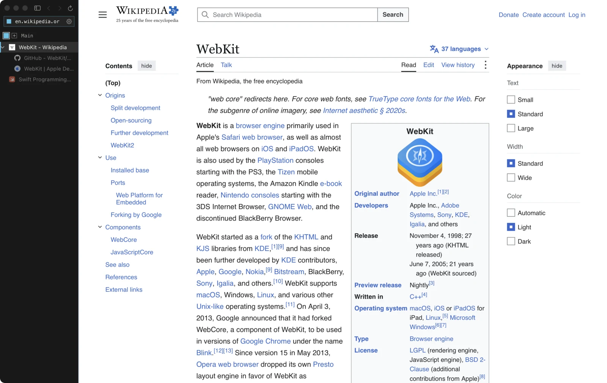

<p align="center">
  
</p>

<h1 align="center">angl</h1>

<p align="center">
  A small, keyboard-first browser for macOS.<br>
  Tree tabs, Spaces with isolated Containers and plain-file config, on the system WebKit.
</p>

<p align="center">
  <a href="https://github.com/btuckerc/angl-browser/releases/latest"><b>Download for Apple Silicon</b></a> ·
  <a href="#build-from-source">Build from source</a> ·
  <a href="#use">Use</a> ·
  <a href="#limits">Limits</a>
</p>

<p align="center">
  
</p>

Per-site JavaScript, blocker, dark mode and volume controls, Bitwarden and Apple Passwords,
and no URL bar unless you want one. Inspired by dacctal's LibreWolf + Sidebery + userChrome
setup ("what browser is that?").

The engine is the system WKWebView (WebKit, updated with macOS) in a Swift 6 / AppKit shell.
No bundled engine, no Electron: the app is a few MB and shares WebKit with the OS.
On en.wikipedia.org/wiki/WebKit, total footprint (app plus its WebKit processes) was
227 MB for angl, 287 MB for Safari and 427 MB for Search.app.

## Install the app

Download the ZIP from [GitHub Releases](https://github.com/btuckerc/angl-browser/releases/latest),
unzip it and move **angl.app** to **Applications**. Requires macOS 15 or later on Apple Silicon.

Release downloads are Developer ID–signed and notarized by Apple, with a stapled ticket; macOS
may still ask you to confirm opening a downloaded app. There is no automatic updater: quit angl
and replace it with the latest download. `>Make angl the Default Browser` in the command
palette (⌘K) registers it for http/https.

## Build from source

Requires a Mac with Xcode 27 (Swift 6.4, macOS 27 SDK) and [rustup](https://rustup.rs) for the
Bitwarden bridge (`bitwarden/rust-toolchain.toml` pins the toolchain).

```sh
git clone https://github.com/btuckerc/angl-browser.git
cd angl-browser
scripts/bitwarden.sh && swift test                # builds the Bitwarden bridge, runs the unit tests
ANGL_SIGN_IDENTITY=- scripts/bundle.sh --install   # ad-hoc signed; replaces /Applications/angl.app
```

`bundle.sh` builds the Bitwarden SDK bridge (`scripts/bitwarden.sh`: `bitwarden/` →
`build/bitwarden/libangl_bitwarden.a`), builds release, compiles the filter lists (daily), compiles the icon
(`packaging/AppIcon.icon`, an Icon Composer vector, via `actool` into `Assets.car` + `.icns`),
assembles `build/angl.app`, signs it with hardened runtime (`ANGL_SIGN_IDENTITY`, default the
maintainer's Developer ID) and with `--install` replaces `/Applications/angl.app`.

Converting and compiling the lists into WebKit content rules (on first launch after they change,
and on every list update) runs in a short-lived `angl --lists` child process, so its several
hundred MB peak never lands in the browser's own footprint.

### Releases

Published builds go through the maintainer's shared `mac-releases` pipeline (`release.py build angl`
→ `notarize` → `draft` → `publish`), which runs `scripts/build-release.py`: the same bundle with the
release version and build number and a secure timestamp, then Apple notarization and a stapled
ticket. Tags are `vVERSION` and match `VERSION`.

## Use

- **No URL bar** by default: **⌘T** floats an address box over the page (a new tab opens
  only when you commit), **⌘L** or a click on the sidebar's address pill edits the current
  URL, **⌘K** opens it with `>` for commands (`>js off`, `>dark force`, `>profile work`,
  `>open safari`, `>container work`, `>space 2`). Return opens here, ⌘Return as a child
  tab, ⇧Return in a new window. An empty tab holds the same field in the page, next to the
  `angl` wordmark, with a blinking accent block for a caret; Esc clears it, then lets go.
  Appearance › Empty tab › Wordmark only turns that off, and Empty-tab caret › System keeps
  the field with the system caret (`"window": {"newTab": "mark"}`, `{"caret": "native"}`).
  Appearance › Address › Bar brings back the always-visible field (`theme.json`:
  `"window": {"address": "bar"}`).
- **Tabs** form a tree: links opened with ⌘-click, middle-click or `window.open` become
  children. ⌘⌥↑/↓ parent/child, ⌃Tab or ⌘⇧[ ] cycle, ⌘1…9, ⌘W closes (on the window's
  last page, in every Space, it closes the window; Settings › Tabs turns that off),
  ⌘⌥W closes with children, ⌘⇧T reopens the last closed tab (`a ` in the palette searches
  archived ones). Drag rows to re-parent; right-click for pin, duplicate, folders,
  Container and Space moves. Pinned tabs sit above the tree as titled rows. A speaker
  marks tabs making sound (WebAudio included); muted tabs show it struck through.
- **Bookmarks** (⌘D) come up in the palette (`b ` searches only them). Right-click a
  bookmark there or in Favorites to open it in a new tab, window or split, copy the link,
  add or remove it from Favorites, edit its title and address, or delete it.
- **Spaces** (⌃1…9, ⌃⇧←/→, the squares in the sidebar; ＋ adds one) each have a tab tree
  and a default Container; `angl://spaces` edits and deletes both (deleting a Container erases
  its cookies and storage; its Spaces and tabs move to another). A new Space shares the current
  Container. Containers have separate cookies and storage, an optional HTTP/SOCKS5 proxy
  and clear-on-quit; a tab can override its Container from the site panel. URL rules move
  matching sites into a Space (Settings › Tabs › Move matching tabs to Spaces).
- **Settings › Tabs**, all optional: *Memory saver* unloads tabs idle for 30 minutes
  (pins, playing media, camera/mic and visible panes exempt; 0 = off). *Auto-archive* (off) moves
  tabs idle for 24 hours to History › Archive. *Favorites* (off) shows bookmarked
  favourites as an icon row in every Space. *Split view* (off) shows two tabs of a Space side
  by side: ⌥⌘\\ picks the second tab or exits, ⌥⌘←/→ moves focus (the focused pane has an
  accent outline), drag the divider.
- **Site controls** (⇧⌘I or the gear in the address pill): JavaScript (⇧⌘J), blocker, remote fonts,
  square corners (⇧⌘U), dark mode (⇧⌘D, off/auto/force), hardening, volume −30…0 dB,
  mute (⇧⌘M, the whole page including WebAudio), zoom.
- **Night audio** (Settings › Pages › Media, off): compresses loud/quiet swings in Media Source
  video (YouTube, Twitch) with Web Audio's `DynamicsCompressorNode` at FrankerFaceZ's defaults
  (threshold −50 dB, knee 40, ratio 12, release 0.25 s). WebKit outputs silence when a page routes
  MediaSource video through Web Audio (FFZ's approach), so a page script decodes the audio the
  site appends with WebCodecs, plays it compressed in sync with the video and turns the video's
  own audio track off. No permissions; everything stays in the page. Switching it on applies from
  the next page load; switching it off takes effect at once.
- **Hardening** (Settings › Pages › WebKit security mode, or per site): `noJIT` runs JavaScript without the JIT
  (macOS 26.4+), `lockdown` is WebKit Lockdown Mode. JavaScript itself stays on by default;
  switch it off globally or per site.
- **Forget on quit** (Settings › Privacy): deletes every site's cookies and storage at quit
  except the domains in *Keep signed in* (default google.com, youtube.com).
- **Passwords** (Settings › Passwords): Bitwarden built in (the official Bitwarden SDK runs
  in-process; bitwarden.com, bitwarden.eu, or a self-hosted Bitwarden or Vaultwarden server —
  pick *Self-hosted* in the login sheet and enter its address) and Apple Passwords. On a
  sign-in page a picker drops under the field — *Log in to Bitwarden…* / *Unlock Bitwarden…*,
  then the logins matching the frame's site (Bitwarden's URI match rules and equivalent
  domains); ↑ ↓ ↩ esc work while it is up. **⌘\\** offers logins on demand. Picking fills
  username and password (never submits), asks for the master password first on re-prompt
  logins, and copies the TOTP code if there is one (**Copy one-time code after filling** turns
  that off). Two-step login takes authenticator, email and YubiKey OTP codes; for Duo or
  security keys log in with a personal API key. The encrypted vault is cached in the profile,
  so unlocking works offline, and syncs when the server reports a change. Keys stay in memory
  (with **Remember unlock**, also sealed to the Secure Enclave and opened by Touch ID or the
  login password); Edit › Lock Bitwarden or idle/screen lock drops them from memory.
  *Apple Passwords…* opens a native sheet with the system AutoFill picker and
  fills what you choose there. Settings › Passwords turns either off.
- **Ad blocker**: AdGuard Base + Tracking Protection (Safari-optimized lists, converted
  by AdGuard's SafariConverterLib into WebKit content rules) plus AdGuard Scriptlets and
  cosmetic rules for sites such as YouTube. Settings › Privacy › Content-blocking lists picks lists (toggling one
  rebuilds), toggles the advanced rules; the site panel turns the blocker off per site.
  **AdGuard Cookie Notices** (off by default) hides consent banners and clicks some away —
  often "reject", sometimes "accept"; it goes off with the site's blocker.
- **Twitch emotes**: BTTV, FFZ and 7TV emotes render in twitch.tv chat (Settings › Pages › Twitch chat:
  per provider, animated or still, or off).
- **Focus mode** ⇧⌘\ hides the chrome; ⇧⌘L (or the sidebar button next to the traffic
  lights) hides the sidebar; hover the left edge to peek. Appearance sets the edge catch
  width (0 turns peeking off), peek/hide delays, and whether the Space selector sits
  at the top or bottom of the sidebar.
- **Window outline** (Appearance): none (default) leaves the edge to macOS, seam colours
  the sidebar divider, content insets the page in a rounded frame. Colour: accent, border,
  active container or custom; width and active/inactive opacity are adjustable. The accent
  swatches are angl, white, blue, yellow, pink, or any custom colour. Hairlines and borders
  are tinted from the accent unless `theme.json` pins `"color": {"border": "#rrggbb"}`.
- **Snapshots** (⇧⌘S, automatic every 10 min) save every window, Space and tab;
  `angl://snapshots` restores them. ⇧⌘O hands the page to another installed browser.
- Pages: `angl://settings`, `spaces` (Spaces and Containers), `sites`, `history` (⌘Y), `downloads` (⌘⌥L),
  `snapshots`, `about` (profiles, import from Safari/Chrome/Search, keys).
- **History** (⌘Y) lists visits newest first, grouped by day, with Archive and Closed tabs
  beside it. ↓ from the search box walks the rows, ⌫ forgets the focused one, ⎋ returns
  to search. The palette's `h ` filter ranks the same history by frecency instead.
- `>Make angl the Default Browser` registers angl for http/https.

## Files

| Path | What |
|---|---|
| `~/.config/angl/theme.json` | colours, fonts, sizes (live-reloaded) |
| `~/.config/angl/settings.json` | any subset of the settings |
| `~/.config/angl/keys.json` | `{"tab.new": "cmd+t", "tab.mute": ""}`; ids on `angl://about` |
| `~/.config/angl/css/_global.css`, `<host>.css` | user CSS for every page / one site |
| `~/.config/angl/css/_angl.css` | CSS for angl's own pages |
| `~/Library/Application Support/angl/<profile>/` | session, history, workspaces, sites, snapshots, lists |

Profiles are separate instances: `open -na angl --args --profile NAME`.

## Limits

- Passkeys need an entitlement only Apple-reviewed browsers get: a failed passkey
  prompt offers "Open in Safari" and can remember that per host.
- No extensions. Find has no match count. Volume only attenuates, and only the page's
  audio/video elements (not WebAudio or detached `Audio()` objects); mute covers everything.
- Night audio covers Media Source video with one audio stream at 1× speed. Other media
  (progressive files, native HLS, page Web Audio), DRM, Media Source in workers, other speeds and
  codecs WebCodecs can't decode play uncompressed; the switch back fades over about half a second.
  Compression is per video, not one mix of the tab. Per-site volume is applied before compression.
  WebKit starts the audio context only after a click or key press on the page.
- Geolocation and notification prompts are not offered.
- Apple Passwords has no API for third-party browsers: the picker is the system AutoFill
  sheet, without site matching, and no saving of new logins.
- Cookie notices and other advanced rules run only for the page's own site: consent dialogs
  inside third-party frames (Sourcepoint, TrustArc…) are hidden from the page side at best.
  Extended selectors (`:has-text`, `:xpath`, `:upward`) are not supported, and banners in
  shadow DOM are out of reach.

## Licence

[GPL-3.0](LICENSE).

The blocker uses AdGuard SafariConverterLib and vendors AdGuard Scriptlets, both GPLv3
(licences and notices in `Resources/web/inject/*.LICENSE`, `*.NOTICE`), so angl builds are GPLv3.
The Bitwarden bridge links the Bitwarden SDK crates under their GPL-3.0 option
(`GPL-3.0-only OR LicenseRef-Bitwarden-SDK`); the build sets `bitwarden_ensure_non_commercial`,
which makes any crate without the GPL option a compile error.
